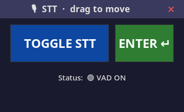

<div align="center">

# localstt

**Local voice dictation: press to record, release to transcribe.**

Hold a hotkey (or speak near the mic in VAD mode) and your words are typed
into whatever window has focus. Recording and transcription both run on your
own GPU, via [faster-whisper](https://github.com/SYSTRAN/faster-whisper).

[](LICENSE)
[](pyproject.toml)
[](.github/workflows/ci.yml)
[](#what-is-localstt)



<sub><a href="#what-is-localstt">About</a> · <a href="#install">Install</a> · <a href="#use">Use</a> · <a href="#config">Config</a> · <a href="#privacy">Privacy</a></sub>

</div>

## What is localstt?

No cloud, no account, no API key, no telemetry. Audio never leaves the
machine: capture, transcription, and typing all run locally. An optional
cleanup pass can polish a transcript through a llama.cpp server you run
yourself, still on `127.0.0.1`, off by default.

| Piece | Source | What it does |
|---|---|---|
| daemon | `stt/daemon.py` | records the mic, runs faster-whisper, types text via `xdotool` |
| controls popup | `stt/controls.py` | mouse-only Start/Stop + Enter window, no hotkey needed |
| tray | `stt/tray.py` (optional) | pystray icon that supervises the daemon; headless fallback without pystray |

Two capture modes, combinable: **hotkey** (hold `<ctrl>+<shift>+space`,
release to transcribe) and **VAD** (the daemon transcribes when you stop
talking). Linux + X11 required for typing; an NVIDIA GPU is recommended, a
CPU works but is slower.

## Install

```bash
sudo apt install xdotool   # typing backend
pip install localstt       # or: pip install -e .
pip install "localstt[tray]"   # optional: tray icon
stt-daemon start
stt-controls               # open the control popup
```

The popup auto-starts the daemon when it needs one. A systemd user unit
(`stt.service`) is included if you want the tray to start with your session.

## Use

| Command | Effect |
|---|---|
| `stt-daemon start` | start the daemon in the background |
| `python3 -m stt.daemon set-mode hotkey` | hotkey \| vad \| both \| off |
| `python3 -m stt.daemon --test` | record 2 s + transcribe, no typing |
| `python3 -m stt.daemon status` | print daemon state |

The popup works mouse-only: TOGGLE STT switches voice-activity capture,
ENTER types a committed transcript into the focused window.

## Config

Defaults work out of the box. Override per setting with an env var or a
small INI at `~/.stt/stt.conf` (`[stt]` section); env wins.

| Setting | Env | Default |
|---|---|---|
| whisper model | `STT_MODEL` | `base` |
| device | `STT_DEVICE` | `cuda` |
| hotkey | `STT_HOTKEY` | `<ctrl>+<shift>+space` |
| VAD threshold | `STT_VAD_THRESHOLD` | `0.05` |
| silence limit (s) | `STT_VAD_SILENCE` | `1.5` |
| max utterance (s) | `STT_VAD_MAX_UTTERANCE` | `10.0` |
| cleanup pass | `STT_CLEANUP` | off |
| cleanup server port | `STT_BIG_MODEL_PORT` | `11599` |
| state dir | `STT_STATE_DIR` | `~/.stt/state` |

## Privacy

Recording, transcription, and typing are local by construction. The only
network use is the optional cleanup pass, which talks to `127.0.0.1` and
nothing else. Whisper model weights are downloaded from their upstream
host on first use.

## Development

Built with AI assistance and verified by tests and CI.

Third-party components: [faster-whisper](https://github.com/SYSTRAN/faster-whisper)
(MIT) for transcription and the [Whisper](https://github.com/openai/whisper) models
(MIT) it loads; typing uses [xdotool](https://github.com/jordansissel/xdotool).
Apache-2.0; see [LICENSE](LICENSE).
